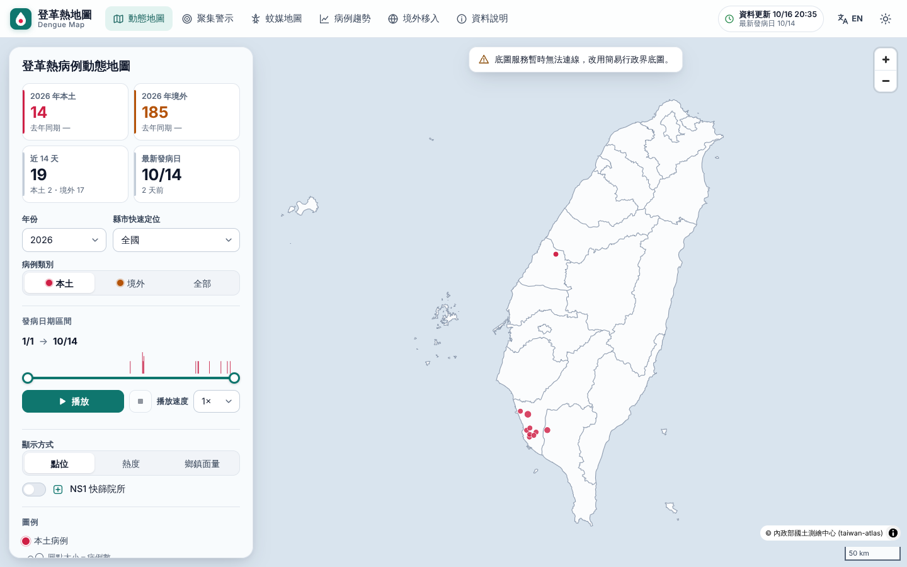
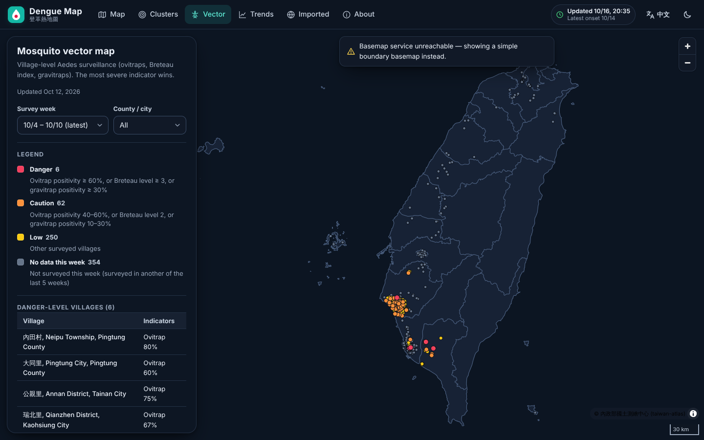
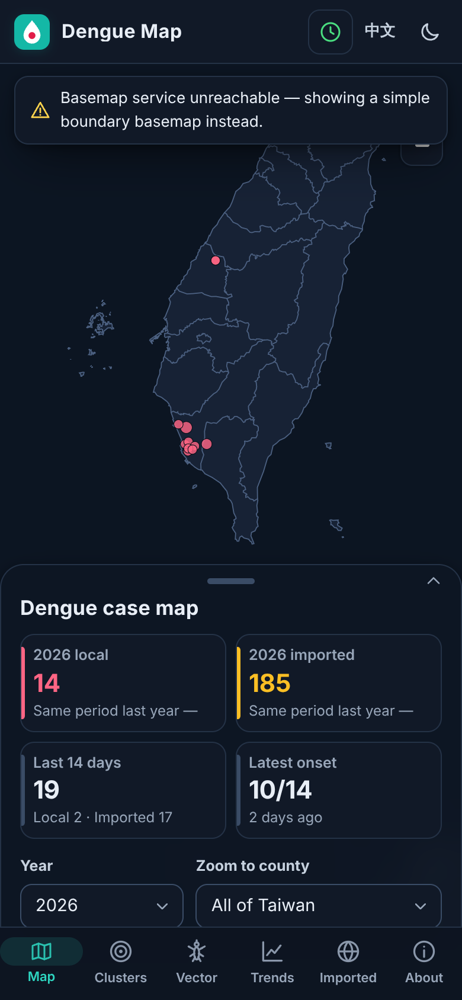

# 登革熱地圖 Dengue Map（現代化版）

**線上網址：<https://ancientsky.github.io/denguemap/>**

疾管署「登革熱地圖」（[cdcdengue.azurewebsites.net](https://cdcdengue.azurewebsites.net/)，2015 年上線）的現代化重製版：深／淺色佈景、中／英文介面、手機友善、純靜態網站部署於 GitHub Pages。

| 淺色・中文 | 深色・英文 | 手機 |
|---|---|---|
|  |  |  |

> 截圖為離線測試環境，底圖改用內建的行政界簡圖；線上版使用 OpenFreeMap 向量底圖。

## 功能

- **動態地圖**：病例點位（最小統計區中心點）、日期區間＋播放、本土／境外、縣市定位、點位／熱度／鄉鎮面量圖、NS1 快篩院所
- **聚集警示**：近兩週群聚區域與近 14 天本土病例鄉鎮
- **蚊媒地圖**：村里病媒蚊風險（近 5 週）、危險級里別表、CSV 下載
- **病例趨勢**：1998 年起每日／每週流行曲線、歷年同週比較、年度長條圖
- **境外移入**：各國移入弧線（地球投影）、國家排行、疾管署國際疫情資訊
- **資料說明**：來源、更新時間、隱私、資料品質警示
- **嵌入模式**：`?embed=1` 可用 iframe 嵌入其他網站（隱藏標題與導覽、Ctrl＋滾輪縮放、佈景／語言由網址決定且不寫入偏好）→ [docs/embedding.md](docs/embedding.md)

## 架構

```
GitHub Actions（每 3 小時） scripts/data → public/data/*.json（有變動才 commit）→ vite build → GitHub Pages
```

- 前端：Vite + TypeScript（無框架）、MapLibre GL 6、ECharts 6（只在趨勢頁載入）
- 資料：抓疾管署登革熱地圖後端，驗證後輸出靜態 JSON；來源失敗時沿用上一版，不會部署空資料
- 詳細研究與設計：[docs/research.md](docs/research.md)；資料格式：[docs/data-contract.md](docs/data-contract.md)；嵌入方式：[docs/embedding.md](docs/embedding.md)

## 開發

```bash
npm ci
npm run dev          # http://localhost:5173/denguemap/
npm run check        # typecheck + 單元測試 + build + Playwright 煙霧測試
npx vitest run       # 全部測試（前端 + 資料管線）
npm run data         # 重新抓資料（需能連到來源主機，一般在 GitHub Actions 執行）
```

手動更新資料：Actions → `data` → Run workflow（`allow_shrink` 只在疾管署正式下修數字後使用）。

## 資料與免責

- 資料來源：衛生福利部疾病管制署。**正式數字以疾管署公布為準。**
- 地圖座標為「最小統計區」中心點，非個案住址。
- 上游 2023–2025 年資料目前不完整，網站會明確標示（見「資料說明 → 資料品質」）。
- 底圖：© [OpenFreeMap](https://openfreemap.org) © [OpenMapTiles](https://www.openmaptiles.org/) © [OpenStreetMap contributors](https://www.openstreetmap.org/copyright)；行政界：內政部國土測繪中心（taiwan-atlas）。
